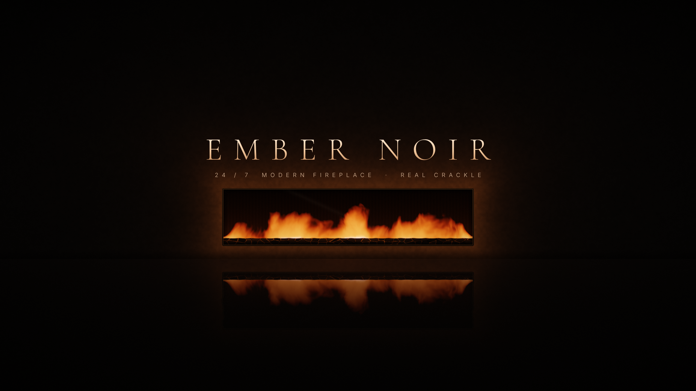
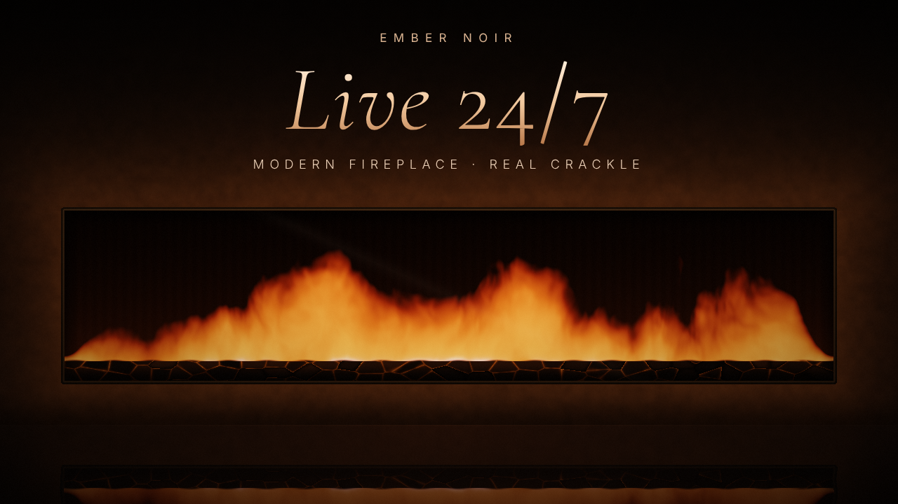
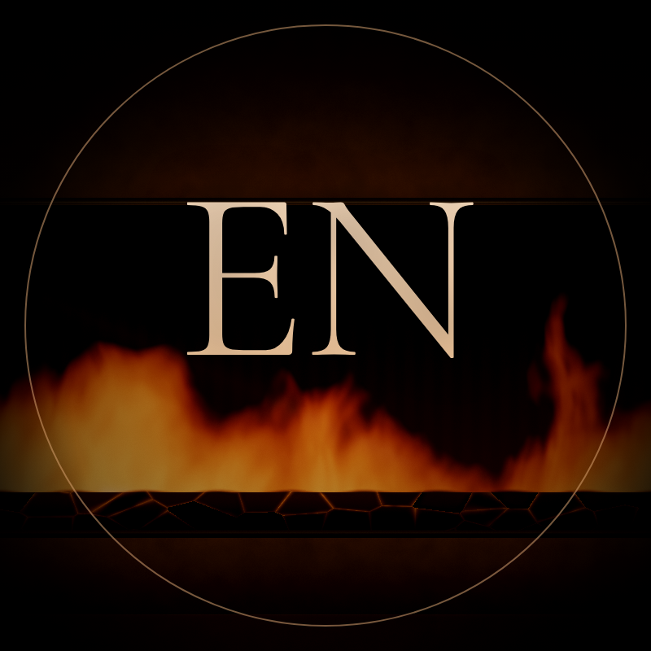

# EMBER NOIR — 24-Hour Modern Fireplace



Everything needed to run a **24/7 fireplace YouTube channel** with a modern, moody look and real
crackling fire sound:

- **The fire**: a sleek linear fireplace (black microcement wall, bronze frame, glass, ember-stone bed,
  glossy black hearth reflection), rendered in WebGL as a **perfectly seamless loop**.
- **The sound**: a wood-fire soundscape (low roar, flame flutter, crackle clusters, sap pops, log settles,
  warm room reverb), also a seamless loop, mastered to ~-20 LUFS.
- **The stream**: a one-command, auto-reconnecting 24/7 YouTube Live streamer (plus Docker/systemd).
- **The uploads**: 1-hour master and 10-hour upload videos built in seconds, with no re-encode.
- **The channel**: banner, avatar, watermark, thumbnails, and copy-paste titles/descriptions/tags
  ([channel/CHANNEL.md](channel/CHANNEL.md)).

| Thumbnail | Avatar |
|---|---|
|  |  |

## The 24-hour fireplace

Most fireplace videos stop at 10 hours because **YouTube won't accept an upload longer than
12 hours** (or 256 GB). There are two ways to get the full 24 hours:

| Goal | Command | Result |
|---|---|---|
| **24 hours on YouTube** | `make live-24h` | One 24-hour **live broadcast** titled "24 Hour Fireplace". It runs exactly 24 h, reconnects if the internet blips, then stops by itself. |
| **A 24-hour video file** | `make video-24h` | `build/ember_noir_fireplace_24h.mp4`, a true 24:00:00 video (~69 GB) for smart TVs, USB sticks, Plex, Vimeo, or your own site. |
| 12-hour YouTube upload | `make long HOURS=12` | The longest YouTube will take as a regular video. |

YouTube doesn't keep a replay of streams longer than 12 hours, so the 24-hour broadcast is watchable
while it's live. Re-run it whenever you like (for example every weekend, or on holidays), or leave
`DURATION_HOURS` empty to keep it on 24/7.

## Fastest path (no rendering)

The repo ships a pre-rendered loop and audio in `media/`, so you only need `ffmpeg`:

```bash
scripts/build_master.sh                 # → build/fireplace_master_1h.mp4  (~2.7 GB, under a minute)
cp config.env.example config.env        # paste your YouTube stream key
DURATION_HOURS=24 scripts/stream_24_7.sh   # 🔥 live for 24 hours, then stops
```

`media/preview_20s.mp4` is a 20-second clip with sound if you want a look and listen first.

## Quick start (build everything yourself)

Requirements: `ffmpeg`, `python3` + `numpy`, and `node` + `playwright` (only for rendering video and art).

```bash
make audio       # build/fire_audio.wav: 10-min seamless fire sound   (~1 min)
make video       # build/fire_loop.mp4: 60-s seamless 1080p30 loop    (~15 min on CPU, far faster with a GPU)
make master      # build/fireplace_master_1h.mp4: 1-hour master        (seconds)

make stream-test # writes 20 s to build/stream_test.flv to sanity-check
cp config.env.example config.env   # paste your YouTube stream key
make stream      # 🔥 live, forever (Ctrl-C to stop)

make video-24h       # build/ember_noir_fireplace_24h.mp4, the full 24-hour file
make live-24h        # one 24-hour YouTube live broadcast, then stop
make long HOURS=12   # longest regular YouTube upload
make branding        # re-render channel art (CHANNEL_NAME="..." to rebrand)
```

Just want to look at it? Open `fireplace/index.html` in any browser. It runs live on your GPU, so it
also works as an OBS *Browser Source* if you'd rather stream from OBS.

## Going live on YouTube

1. YouTube Studio → **Create → Go live → Stream**. (A new channel must be verified, and the
   first live stream unlocks up to 24 hours after you request it.)
2. Copy the **stream key** into `config.env`. Turn **Auto-stop off** and **DVR off**.
3. Run `make stream` on a machine that stays online. Recommended: a small Linux VPS
   (2 vCPU and ~8 Mbps upload is plenty in the default `copy` mode, since nothing is re-encoded).
   - **systemd:** copy the repo to `/opt/ember-noir`, then install `deploy/fireplace-stream.service`.
   - **Docker:** `docker build -f deploy/Dockerfile -t ember-noir . && docker run -d --restart=always -e YT_STREAM_KEY=... ember-noir`
4. The streamer loops the 1-hour master forever and reconnects automatically if YouTube or the
   network drops the connection.

YouTube splits archives of streams longer than 12 hours, so for a 24/7 stream keep DVR/archiving off.

## Using a recorded fire instead

The included audio is synthesized from scratch, so it's 100% yours and safe to monetize. If you have a
recording you like better (your own, or licensed/CC0), drop it in and rebuild:

```bash
scripts/build_master.sh build/fire_loop.mp4 path/to/my_fire.wav
```

You can also mix both layers, e.g. a real recording plus the generated crackle for extra pops.

## Tweaking the look

All the art direction lives in `fireplace/index.html` (one fragment shader):

| Want | Change |
|---|---|
| Taller / calmer flames | `tall` and the `1.05` height falloff in `firebox()` |
| Hotter / whiter fire | `fireRamp()` stops |
| Bigger / smaller firebox | `BOX_W`, `BOX_B`, `BOX_T` |
| Brighter room glow | `glow` in `room()` |
| Stronger hearth reflection | `refl` multiplier in `scene()` |
| Loop length | `make video LOOP=120` (audio loops independently every 10 min) |

Render a 4K version with `node scripts/render_loop.js --w 3840 --h 2160 --out build/fire_loop_4k.mp4`
(raise the bitrate caps in the script; YouTube recommends 13–34 Mbps for 4K live).

## Layout

```
fireplace/index.html          WebGL fireplace (live preview + offline render hook)
audio/generate_fire_audio.py  seamless fire soundscape generator (numpy)
scripts/render_loop.js        renders the loop → MP4 (parallel, headless Chromium → ffmpeg)
scripts/build_master.sh       video loop + audio loop → 1 h master
scripts/make_long_video.sh    master → N-hour video (24 h by default), no re-encode
scripts/stream_24_7.sh        YouTube Live streamer: fixed 24 h or forever, auto-reconnect
scripts/render_branding.js    banner / avatar / watermark / thumbnails
deploy/                       Dockerfile + systemd unit
channel/CHANNEL.md            names, About text, titles, tags, playlists, growth notes
branding/                     rendered channel art
media/                        pre-built 60 s loop, 10 min audio, 20 s preview
```
